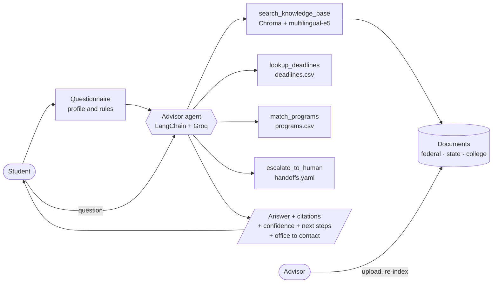

# FirstGen Navigator AI


**A college advisor that answers only from the documents, and tells you when it does not know.**
Bilingual (English and Arabic) for first-generation and immigrant students who have no one at home who has been through the system.

Built for the Chicago Education Advocacy Cooperative (ChiEAC) · Author: Roaa Abu Arra

> **Status:** work in progress (fellowship project, October to December 2026). Numbers in this file are marked with the date they were measured.

---

## The idea in one minute

Imagine Layla. She is the first in her family to apply to college. Her parents have no Social Security numbers, she works 25 hours a week, and her aid status just changed to "Verification". She does not know the word "verification", she is not sure who to ask, and the websites are written for people who already know the system.

Most chatbots would answer confidently, sound helpful, and sometimes be wrong. For a student deciding about money, that is not harmless. So this one is built around four promises:

| Promise | How it is kept |
|---|---|
| **It answers only from official documents** | A search tool over an institution's own pages and federal and Illinois aid rules. No documents, no claim. |
| **It shows its sources** | Every answer cites the passages it used, with a confidence label (High, Medium, Low). |
| **It says "not found" instead of guessing** | Out-of-scope questions are refused; missing facts are reported as missing. |
| **It hands the student to a person** | For personal situations (own aid, verification, immigration, safety) it names a real office to contact. |

It never asks about immigration status, stores no conversation, and accepts only public institutional documents.

## What a student can do

- **Answer a short questionnaire** (stage, work hours, family responsibilities, language, money) and get a **personal plan** with next steps and deadlines, downloadable as a PDF.
- **Chat** in English or Arabic (right-to-left, including the PDF) and get cited, confidence-labeled answers.
- **See the office to contact** when a question needs a person.

## What an advisor can do (no code)

An **Admin page** (`/Admin`, password protected) lets staff upload public documents (PDF, Word, Markdown, HTML), edit the deadlines and programs tables, re-index, and read a **Coverage Report**: which test questions the knowledge base cannot answer, and which documents are getting old.

## How it works



- **Three layers of knowledge:** federal, Illinois state, and the college. Newer documents win when two disagree, and the answer says so.
- **Tools, not memory:** the model has no facts of its own to lean on. It searches, then writes the answer, then a structured pass fills the citations, the confidence and the contact.
- **A safety net in code:** if a question clearly needs a person (immigration, a crisis, verification, a parent's documents) and the model forgets, the code adds the office itself.
- **One folder per institution:** documents, two tables, hand-offs, rules and test questions. Changing the `INSTITUTION` setting is all it takes to serve another college.

## How I know whether it works

62 test questions (English and Arabic): ones it should answer, ones it should refuse, and sensitive ones where it must send the student to a person. Every answer is checked by plain code (is there a citation, does the source exist, was it returned by a tool) and by an **LLM judge** (a different model that splits the answer into claims and checks each against the cited text).

Targets from the project brief: groundedness at least 85%, correct refusal at least 9 of 10, a hand-off on every sensitive question.

**Interim results (2026-11-27, answers still being re-run with the final code):**

| Measure | First 25 questions (before fixes) | Next 19 questions (after fixes) | Target |
|---|---|---|---|
| Cited sources that exist | 24 of 24 | 15 of 15 | all |
| Groundedness (judge) | 69% | 74% | 85% |
| Hand-off on sensitive questions | 1 of 11 | 3 of 7 | all |

**What the evaluation taught me.** The best finding was a bug no test would have caught: the search tool showed the model only the first 150 characters of each passage. That is why it could not find the maximum Pell Grant (the number sat after character 150) and why it invented steps to fill the gaps. After the fix, the same question was answered and supported by its source. The full re-run, the final numbers and the reproducible report are in [`evals/eval_report.md`](evals/eval_report.md).

Reproduce everything with one command:

```powershell
python -m evals.run_eval
```

## Quick start (Windows PowerShell)

```powershell
git clone https://github.com/RoaaRaed/firstgen-navigator.git
cd firstgen-navigator
python -m venv .venv
.venv\Scripts\Activate.ps1
pip install -r requirements.txt
copy .env.example .env   # then add your own API key to .env
```

Requires Python 3.11 or later. A free [Groq](https://console.groq.com) API key is enough.

```powershell
python -m core.ingest            # builds the search index (chroma_db/) the first time
streamlit run app/main.py
pytest -q                        # the automated tests
```

On a machine without `chroma_db/` the app builds the index by itself on start-up (about a minute).

## Docker

```bash
docker build -t firstgen-navigator .
docker run --rm -p 8501:8501 --env-file .env firstgen-navigator
```

The image holds no secrets and does not run as root. A GitHub Action builds it and starts the app on every change to the Docker files. Details: [docs/docker.md](docs/docker.md).

## Add another institution

An institution is a folder under `institutions/` plus one setting, and the target is under four hours. The second one (University of Illinois Chicago) took **25 minutes**, with the time recorded by `scripts/new_institution.py`. Step by step: [docs/white_label.md](docs/white_label.md).

```powershell
python scripts/new_institution.py start uic --name "University of Illinois Chicago"
# ... add documents, tables, hand-offs ...
python scripts/new_institution.py finish uic
```

Serve it with `INSTITUTION=uic` in `.env` or in the app's Secrets.

## What it costs

The only variable cost is the Groq API. Embeddings, the search index and hosting are free. A preliminary model puts it at roughly **$0.007 per conversation** (3 questions), so about $3.50 a month for a one-office pilot and about $14 for one college. The free Groq tier covers roughly 15 to 20 questions a day, enough for development and a small demo. See [docs/cost_model.md](docs/cost_model.md) (preliminary until the full evaluation gives measured token counts).

## Deploy to Streamlit Community Cloud

1. Push to GitHub, then on share.streamlit.io choose **Create app**: repository `RoaaRaed/firstgen-navigator`, branch `main`, main file `app/main.py`.
2. In **Advanced settings** pick **Python 3.11**, and paste `.streamlit/secrets.toml.example` into **Secrets** with your real `GROQ_API_KEY` and an `ADMIN_PASSWORD`. Never commit keys.
3. Deploy. The first start downloads the embedding model and builds the index (a few minutes).
4. In **Settings > Sharing** restrict viewing to the people who should see the demo. Every question uses the project's Groq quota, so the link should not be public.

## Privacy and safety

- The questionnaire never asks about immigration status.
- Nothing a student types is logged or stored by the app (`tests/test_privacy.py`). The answers and the note are sent to the Groq API together with the question.
- The Admin page accepts only public institutional documents and reminds staff about FERPA. Never upload student records.
- Sensitive topics (immigration, law enforcement, a crisis) always name a real office.

## Known limitations

- **Free-tier ceiling:** about 15 to 20 questions a day on the free Groq plan; a real pilot needs a paid plan.
- **Groundedness is below target** (see the table above): the advisor can still add small details the documents do not state. The judge is another small model and can be wrong too.
- **Arabic is weaker than English** at naming an office for sensitive questions; the code-side safety net is there for this reason.
- **Admin uploads are temporary on Streamlit Cloud:** the disk is erased on restart. Add the file to the repository to keep it.
- **Error logs may contain student words:** if the Groq API returns an error, its message can appear in the owner's server logs. The app itself keeps no log.
- **Coverage Report** checks search only; it cannot report "most asked questions" because nothing is stored.
- **Spanish** is configuration-ready only; no quality review yet.
- Some documents are copied from web pages on a given date, and can go out of date. The Coverage Report lists old ones.

## Roadmap

- Finish the full re-run and publish the final evaluation numbers.
- Daily question limit per visitor (a count and a date only, no content).
- Spanish interface and review with the community.
- A smaller, cheaper model for easy questions (deadline lookups).
- Per-institution rules and tone, and a pilot with one real office.

## Project structure

| Folder | Purpose |
|---|---|
| `app/` | Streamlit interface (pages, translations, styles, Admin page) |
| `core/` | Retrieval, agent, tools, prompts, hand-off safety net |
| `institutions/` | One folder per institution: config, documents, tables, test questions |
| `evals/` | Evaluation harness, judge and reports |
| `tests/` | Automated tests |
| `docs/` | Cost model, white-label guide, Docker, knowledge-base template |
| `scripts/` | Command-line helpers (new institution, transcripts) |
| `experiments/` | Early prototypes and setup checks |

---

### بالعربي باختصار

**FirstGen Navigator AI** مساعد إرشاد جامعي بالإنجليزية والعربية للطلاب الأوائل في عائلاتهم والمهاجرين. بيجاوب **فقط من الوثائق الرسمية**، وبيذكر مصادره ودرجة الثقة، وبيقول "ما لقيت" بدل ما يخمّن، ولما يكون السؤال عن وضع شخصي (مساعدة مالية، تحقق، هجرة) بيحوّل الطالب لمكتب حقيقي. ما بيسأل عن وضع الهجرة وما بيخزّن شي مما يكتبه الطالب.

## License

[MIT](LICENSE)
